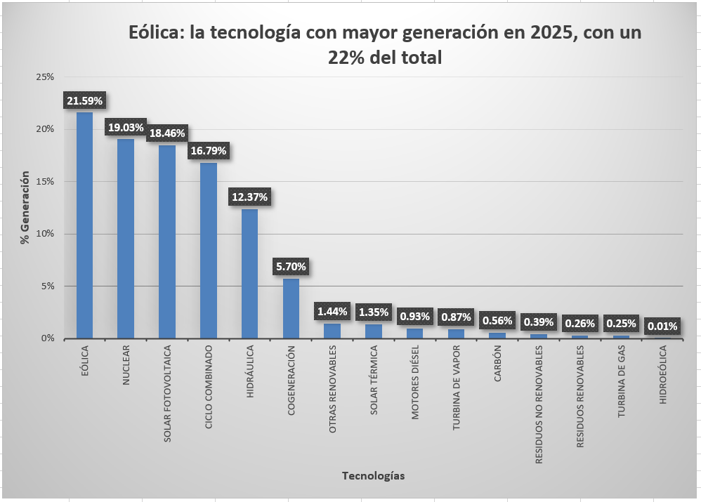
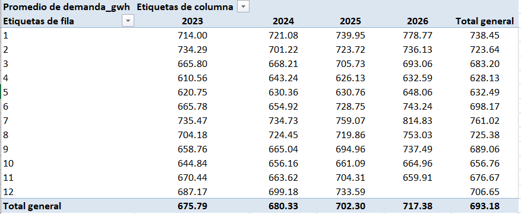

# Demanda eléctrica en España (2023-2026)

**Prueba técnica individual · Career Tech Hub · Empleo Data + IA · Sesión 03**
Autora: Paola Tron Escobosa · Noviembre de 2026

## La pregunta

¿Cómo se comporta la demanda de electricidad en España y de dónde sale esa electricidad? Datos diarios de demanda, generación por tecnología y tiempo, del 01/01/2023 al 15/11/2026.

## La respuesta, en una frase

**La demanda sube cuando la temperatura se aleja de lo templado y cae un 14 % los días de descanso. En 2025, la eólica fue la primera fuente de electricidad (22 %), y más de la mitad de la generación vino del viento, el sol y el agua.**



## Principales resultados

| Pregunta | Resultado |
|---|---|
| A1 · Días con demanda > 800 GWh | 115 en total: 16 (2023), 10 (2024), 25 (2025) y 64 (2026*) |
| A2 · Laborable vs. descanso | Los días de descanso se demanda entre un 13,5 % y un 14,5 % menos, de forma estable todos los años |
| A3 · Mes de mayor y menor demanda | Máximo: julio de 2026 (814,83 GWh). Mínimo: abril de 2023 (610,56 GWh) |
| B1 · Días más calurosos | Los cinco superan la media de su tipo de día, pero solo uno pasa de 800 GWh: tres cayeron en fin de semana |
| B2 · Solar fotovoltaica | De 37,45 TWh (14,2 %) en 2023 a 50,29 TWh (18,5 %) en 2025. El 22,4 % de 2026* está probablemente sobreestimado |
| B3 · Días de lluvia (≥ 1 mm) | Bilbao, 611 días; Valencia, la que menos, 218 |
| Reto · Mayor subida diaria (`LAG`) | 29/04/2025 (+186,71 GWh): recuperación tras el apagón del 28/04/2025 (403 GWh) |
| C1 · Celda no comparable | Noviembre de 2026: solo incluye la primera quincena |
| C2 · Generación 2025 | La eólica fue la tecnología que más generó, con un 22 % del total |

\* Datos de 2026 hasta el 15/11/2026.

**Comprobaciones:** el resultado del reto con `LAG` se verificó con `diff()` en pandas, y los valores de la tabla dinámica de Excel coinciden con los calculados en pandas en la A3.



## Datos

| Archivo | Contenido |
|---|---|
| `data/electricidad.db` | Base de datos SQLite: `demanda`, `generacion`, `tiempo`, `ciudades`, `festivos` y las vistas `temperatura_nacional` y `tabla_dias` |
| `data/electricidad_para_panel.xlsx` | Hojas `dias` y `generacion`, usadas en el cuaderno y en Excel |

Los archivos de `data/` son los originales y no se modifican.

## Cómo ejecutarlo

1. Clona el repositorio:
   ```
   git clone https://github.com/paolabtronescobosa/prueba-individual-sesion03.git
   ```
2. Instala las dependencias:
   ```
   pip install -r requirements.txt
   ```
3. Abre `notebooks/01_prueba_individual_paola_tron_escobosa.ipynb` y ejecuta todas las celdas. Las rutas son relativas (`Path("..") / "data"`), así que funciona sin cambiar nada si se mantiene la estructura de carpetas.
4. Las consultas de la parte B también se pueden ejecutar directamente en SQLite con `sql/consultas.sql`.

## Estructura

```
prueba-tecnica-demanda-electrica/
├── README.md
├── requirements.txt
├── .gitignore
├── data/
│   ├── electricidad.db
│   └── electricidad_para_panel.xlsx
├── notebooks/
│   └── 01_prueba_individual_paola_tron_escobosa.ipynb
├── sql/
│   └── consultas.sql
├── excel/
│   └── parte_c_paola_tron_escobosa.xlsx   ← copia de trabajo con la tabla dinámica y el gráfico
└── docs/
    ├── enunciado.pdf
    └── img/                               ← gráficos del cuaderno y capturas de C1 y C2
```

## Límites del análisis

- **2026 está incompleto** (datos hasta el 15/11/2026). La media anual de 2026, noviembre de 2026 y los porcentajes de ese año no son del todo comparables con los de los años completos. Para compararlos de forma justa habría que usar solo de enero a octubre en todos los años.
- **Temperatura y demanda:** la relación se ve con los 1415 días, pero no permite separar el efecto del clima de otros factores (día de la semana, vacaciones o aumento general del consumo). Para eso harían falta datos de demanda por sector.
- **Lluvia:** en la B3 se cuentan días de lluvia, no la cantidad de lluvia caída.

## Uso de IA

Se usó una IA como apoyo durante la prueba. El detalle de para qué se usó y cómo se comprobaron los resultados está en la respuesta **D4** del cuaderno.
